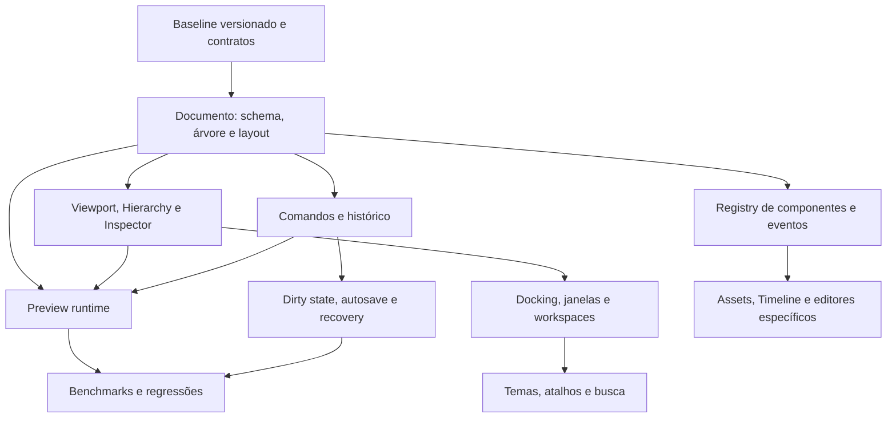

# UCE — diagnóstico técnico inicial e roadmap

**Data da auditoria inicial:** 2026-10-05  
**Atualização de QA:** 2026-10-06  
**Escopo:** reconhecimento estático do checkout disponível, com execução dos testes Haxe que rodam em `--interp`. Esta é a linha de base para decidir a fundação do próximo editor; não é uma auditoria linha a linha de todas as 481 entradas em `source`.

## Resumo executivo

O projeto já tem uma engine Codename/HaxeFlixel funcional, uma arquitetura ampla de mods e assets, scripting por HScript e um adaptador LuaJIT/Psych substancial. Há uma infraestrutura de ferramentas reaproveitável: editores de chart, personagem, stage e alphabet; toolkit comum em `funkin.editors.ui`; UIBuilder registrado no seletor de editores; console/inspector de desenvolvimento; carregamento em camadas de mods e addons.

A fundação do UI Editor existe como protótipo, mas ainda não como modelo de cena reutilizável completo. O UIBuilder conserva uma lista serializada de elementos; schema 2 acrescenta relações pai-filho validadas, agora exibidas em árvore depth-first e editáveis pelo seletor Parent do inspetor. Essa relação é organizacional: posições permanecem absolutas no canvas, sem transformação herdada. Componentes extensíveis, layout declarativo e preview runtime guiado por semântica compartilhada também faltam. A pasta `fnfstudio` contém uma segunda arquitetura de editor, com outro modelo, outra camada de UI, event bus, histórico e plugin manager, mas não está conectada ao fluxo `funkin` nem ao entry point configurado no projeto.

**Recomendação:** evoluir o UIBuilder que já está acessível na engine e usar `funkin.editors.ui` como casca visual. Antes de ampliar funcionalidades, escolher um único modelo serializável para ser a fonte de verdade. Auditar padrões úteis de `fnfstudio`, sem incorporar sua pilha inteira ou criar um terceiro framework.

## Primeiro incremento após a auditoria

O carregamento de JSON inválido no UIBuilder agora falha com uma mensagem explícita em vez de substituir os dados pelo template NVE. `_openJsonDialog` mostra um aviso e só atualiza o projeto depois que a desserialização termina com sucesso, preservando o projeto aberto em caso de erro. `UIBuilderDataTest` cobre a rejeição, a mensagem do erro e o round-trip de um projeto válido; o runner de compatibilidade compila esse módulo puro em uma raiz temporária para evitar as importações globais do restante do engine.

O formato grava `schemaVersion: 2`. Documentos legados sem marcador e documentos schema 1 migram preservando UIDs; versões desconhecidas são rejeitadas. Cada elemento recebe um `uid` persistente, e UIDs ausentes ou duplicados são reparados na leitura/serialização. O campo existente `version` foi mantido para evitar confundir a versão anterior do documento com a versão do schema. `parentUid` é opcional: pai ausente/null significa raiz, e pai inexistente, valor vazio/inválido ou ciclo são rejeitados antes de salvar/carregar. A árvore já existe no modelo serializável, porém a hierarquia ainda não é manipulável na UI; componentes, regras de layout e validação de todos os campos também não foram implementados.

### Incremento atual — hierarquia no schema 2

`UIElementData.parentUid` permite persistir referências entre elementos sem substituir a lista estável usada pelo editor atual. A migração de schema 0/1 preserva UIDs e deixa elementos antigos na raiz. Validação antes de carregar ou serializar detecta referências órfãs e ciclos. O teste `UIBuilderDataTest` cobre migração, round-trip pai-filho, ordem depth-first e rejeição de pais ausentes/cíclicos.

O editor agora projeta essa relação numa árvore hierárquica estável, preservando a ordem dos irmãos no documento; o inspetor oferece seleção de pai e filtra o próprio elemento e descendentes para evitar ciclos. Ao apagar um nó, seus filhos passam ao pai do nó removido (ou à raiz). Não há drag-and-drop, transformação local/ancestral, herança visual ou layout responsivo.

## Incremento atual — dimensões do canvas e criação de componentes

O viewport agora toma `canvasWidth` e `canvasHeight` do documento para desenhar fundo, grade e borda, enquadra o canvas ao abrir/criar/carregar um projeto e usa os limites salvos para selecionar a área vazia. O menu View oferece presets landscape (720p, Full HD, Quad HD, 4K) e portrait (HD, Full HD); ainda não há campos numéricos para dimensões personalizadas. Fundo e borda usam uma textura 1×1 escalada; a grade é a única superfície do tamanho do canvas. Dimensões são limitadas a 4096 por lado e 10 milhões de pixels, limite que inclui 3840×2160, para evitar alocações descontroladas ao abrir JSONs. O posicionamento inicial de componentes usa o centro do canvas. A criação sem tamanho explícito passou a respeitar os tamanhos padrão por tipo já definidos no modelo; por exemplo, Painel começa em 300×200 e Botão em 180×42, em vez de todos nascerem em 200×40.

A leitura, gravação e alteração de dimensão rejeitam valores fora dos limites; uma tentativa inválida não modifica o tamanho atual. `UIBuilderDataTest` cobre o enquadramento em 1920×1080, a aceitação de 4K, a rejeição acima do orçamento e os tamanhos padrão. Na rodada de QA de 2026-10-06, foi reproduzido um deslocamento horizontal ao ajustar o zoom: o FlxCamera ancora o zoom no centro do viewport e introduz um offset quando `zoom != initialZoom`. `UIBuilderData.getCenteredCameraScroll` agora compensa esse offset; testes matemáticos de paisagem e retrato falharam antes da correção e passaram depois. O smoke visual confirmou o centro do canvas em Default, Portrait HD, Portrait Full HD, Full HD, Quad HD e 4K UHD na janela maximizada 1920×1080; Reset View e alteração de tamanho mantiveram o enquadramento. O build Windows release também foi refeito com sucesso. O fluxo de abrir o JSON salvo não pôde ser concluído nesta retomada porque a sessão de automação não disponibilizou controle de janelas nativas; o arquivo foi validado como JSON e o round-trip do modelo segue coberto por teste.

## Arquitetura de implementação

1. **Documento:** `UIBuilderData` é a fonte serializável do projeto; mantém schema, migração e validação sem dependência da UI. Hierarquia, componentes e layout responsivo devem entrar por migração de schema, preservando UIDs e leitura de documentos antigos.
2. **Edição e histórico:** `UIBuilderEditor` coordena ações e seleção; mudanças futuras devem virar operações testáveis, agrupando cada gesto em uma transação de undo/redo. Dirty state, salvamento e recuperação dependem desse limite de edição.
3. **Apresentação:** viewport, Hierarchy e Inspector leem o documento e reutilizam `funkin.editors.ui` para janelas e controles. A renderização de preview deve consumir o mesmo documento por um adaptador de runtime, sem duplicar a semântica dos elementos.
4. **Ambiente de trabalho:** docking, janelas independentes, workspaces, temas e atalhos são preferências do editor, separadas do JSON da interface que o usuário está criando. Antes de projetar undocking em múltiplos monitores, validar a capacidade de janelas do alvo Lime/OpenFL e definir persistência/recuperação quando um monitor não estiver conectado.
5. **Extensões:** componentes e comandos futuros devem se registrar por descritores/capacidades. `fnfstudio` serve para estudar padrões locais de eventos e histórico; sua camada HaxeUI, plugin manager e modelo não devem virar uma segunda fonte de verdade.

Dependências principais: documento validado → árvore/componentes/layout → Hierarchy/Inspector/viewport → transações e recuperação → preview runtime. Docking precisa de um contrato de painel antes de ampliar a quantidade de ferramentas; assets, timeline, eventos visuais, temas e busca dependem dos componentes compartilhados e do modelo estável.

## Limites e validação desta leitura

- A pasta não contém `.git`; `git status` retorna “not a git repository”. Não foi possível confirmar commit, branch, alterações locais ou histórico. Antes desta etapa foi criado o checkpoint externo `..\backups\uce-ui-builder-viewport-prechange-20261005-211302` com os arquivos tocados; isso permite recuperação pontual, mas não substitui um checkout versionado nem fornece diff/histórico.
- Haxe local: **4.3.7**.
- `pwsh -File building/compat-test.ps1 -SkipNativeLua` passou novamente em 2026-10-06: oito execuções de testes de compatibilidade e `UIBuilderDataTest`, incluindo o novo caso de cálculo do scroll centralizado em paisagem e retrato. LuaJIT nativo foi explicitamente pulado.
- `pwsh -File building/compat-test.ps1 -SkipNativeLua -BuildEngine` completou o build Windows release; o executável gerado foi aberto e usado para smoke visual real. A regressão de viewport foi observada e corrigida.
- `pwsh -File building/compat-test.ps1 -SkipNativeLua -GameplaySmoke` passou em 2026-10-06: executou o mod Lua temporário em Bopeebo e confirmou callbacks de criação/atualização/beat/miss, APIs Psych, ordem de dispatch Lua/HScript, parada por `Function_StopLua`, direção de notas e diálogo JSON. LuaJIT nativo continua explicitamente pulado.
- Na janela maximizada 1920×1080, a engine aplicou Default, Portrait HD, Portrait Full HD, Full HD, Quad HD e 4K UHD; zoom/reset e Undo/Redo também foram exercitados. Um Text Label foi criado no centro (propriedades observadas: x=835, y=524, 250×32) e desfeito/refeito durante a rodada. O overlay exibiu aproximadamente 120 FPS; isso é observação pontual, não benchmark nem medição de frame time.
- O projeto `NVEMainMenu-qa.json` foi salvo e validado fora da UI: JSON válido, 1920×1080, 10 elementos e 5.542 bytes. A reabertura interativa ficou inconclusiva porque, após reiniciar o contexto CUA, a API atual listou zero apps e não ofereceu funções de janela nativa; não se deve interpretar isso como confirmação do fluxo de load.
- Os testes cobrem adaptadores, hooks, conversão de diálogo, registry, property paths, capabilities, o modelo puro do UIBuilder e um fluxo gameplay Lua/Psych em uma música/mod de teste. Ainda faltam teste de load via interface, teste prolongado de memória/frame time, carregamento amplo de mods e validação visual em outros tamanhos físicos de janela.

## Mapa da arquitetura observada

| Área | Implementação existente | Estado para evolução |
|---|---|---|
| Inicialização e runtime | `project.xml` aponta para `funkin.backend.system.Main`; `MainState`, `FunkinGame`, `MusicBeatState` e `PlayState` organizam inicialização, troca de estados e gameplay. | Core real da engine; alterações exigem compatibilidade com estados, scripts e mods. |
| Build e dependências | Haxe/Lime/HaxeFlixel, forks de bibliotecas via `building/libs.xml`; LuaJIT e `LUA_ALLOWED` condicionados a C++. CI contém builds de desktop. | Haxe 4.3.7 está presente. O histórico de build deste checkout não pôde ser confirmado pelo Git. |
| Gameplay e FNF | Notas, strumlines, personagens, HUD, chart, cutscenes/diálogo, menus, áudio, animações e tweens estão distribuídos em `funkin.game`, `backend` e editores especializados. | Reutilizar APIs e classes existentes; evitar duplicar runtime e regras de gameplay dentro do editor. |
| Mods, addons e assets | `AssetsLibraryList`, `Paths`, `ModsFolderLibrary`, `ZipFolderLibrary` e `MainState` formam a busca de assets; `ModSwitchMenu` encontra e habilita/desabilita addons. `FunkinCache` mantém camadas de cache. | Infraestrutura já disponível para browser e preview. O diretório `mods` do checkout tem só instruções, sem amostra de mod para inventário de consumidores. |
| Scripting e eventos | HScript é sempre registrado; `ScriptAdapterManager`/`ScriptAdapterRegistry` permitem registrar runtimes por extensão; eventos Haxe tipados chegam aos scripts. LuaJIT/Psych é compilado condicionalmente para C++. | Extensão real já existe em runtime. Mudanças em hooks, callbacks ou objetos globais podem quebrar mods. |
| Compatibilidade Lua/Psych | A documentação local registra 246 nomes de API Psych conectados e diferenças conhecidas de índices de notas, scheduler, diálogo, settings e `runHaxeCode`. `LuaCallbackScope` cria nomes nativos por estado e remove callbacks ao descartar o escopo. | Amplo, mas com equivalência parcial. A matriz e o roadmap de compatibilidade existentes são a fonte atual das lacunas; preservar esses contratos. |
| UI comum dos editores | `funkin.editors.ui` inclui `UIState`, foco/input, janelas, controles, menus de contexto, exploradores de arquivos/imagens e notificações. Editores existentes demonstram gizmos, listas e fluxos de salvar. | Reutilizar como camada visual para o UI Editor; não criar widgets concorrentes sem necessidade. |
| UIBuilder | `EditorPicker` abre `UIBuilderEditor`. Há canvas, seleção/arraste, resize, grid/snap, árvore de hierarquia, seletor de pai no inspetor, presets, JSON, geração de HScript/Lua/XML e undo/redo. Schema 2 preserva relações pai-filho validadas. | Smoke visual Windows confirmou presets e enquadramento após a correção do zoom da câmera. Ainda faltam drag-and-drop na árvore, layout responsivo, docking, workspaces persistentes, teste interativo de load e validação do preview em runtime. |
| `fnfstudio` | Contém `ProjectModel`, elementos, viewport/hierarchy/inspector, node graph, `CommandHistory`, `EventBus`, plugins e entrada própria em `fnfstudio.Main` com HaxeUI. | Isolado do pacote `funkin`; `project.xml` inicia a aplicação Codename. Tratar como protótipo separado e avaliar componentes individualmente. |
| Debugger | `ConsoleUI` é ligado pelo `Main`, usa ImGui quando `IMGUI_ENABLED` está ativo, oferece ring buffer de 100 entradas, filtros por tipo/nível, autocomplete/histórico, console HScript e inspector. F2 é a configuração padrão do console; existe caminho para console nativo. | Muito mais infraestrutura existente do que uma simples caixa de log. Estender o console/inspector atual e testar build com/sem ImGui. |
| Cache e performance | Há cache de assets próprio, limpeza entre estados, contadores de FPS/memória e opção de Tracy. `project.xml` pré-carrega assets em targets não-web por padrão. | Não há medições de frame time, RAM, alocações ou startup registradas nesta auditoria; medir antes de alegar ganhos. |
| Documentação e status | A documentação é mais desenvolvida para compatibilidade (`docs/compatibility/*`). Não encontrei um registro geral de arquitetura/roadmap da UCE no diretório `docs`. | Este arquivo cria o primeiro registro geral e pode ser atualizado após cada etapa. |

## Referências principais

- **Runtime/build:** [project.xml](../project.xml), [Main.hx](../source/funkin/backend/system/Main.hx), [MusicBeatState.hx](../source/funkin/backend/MusicBeatState.hx), [PlayState.hx](../source/funkin/game/PlayState.hx).
- **Assets/mods/cache:** [AssetsLibraryList.hx](../source/funkin/backend/assets/AssetsLibraryList.hx), [Paths.hx](../source/funkin/backend/assets/Paths.hx), [MainState.hx](../source/funkin/backend/system/MainState.hx), [FunkinCache.hx](../source/funkin/backend/system/modules/FunkinCache.hx), [ModSwitchMenu.hx](../source/funkin/menus/ModSwitchMenu.hx).
- **Scripting/compatibilidade:** [ScriptAdapterManager.hx](../source/funkin/backend/scripting/ScriptAdapterManager.hx), [LuaScript.hx](../source/funkin/backend/scripting/LuaScript.hx), [ScriptAdapterRegistry.hx](../source/cne/compat/ScriptAdapterRegistry.hx), [COMPATIBILITY-MATRIX.md](compatibility/COMPATIBILITY-MATRIX.md), [COMPATIBILITY-ROADMAP.md](compatibility/COMPATIBILITY-ROADMAP.md).
- **UIBuilder/toolkit:** [EditorPicker.hx](../source/funkin/editors/EditorPicker.hx), [UIState.hx](../source/funkin/editors/ui/UIState.hx), [UIBuilderEditor.hx](../source/funkin/editors/uibuilder/UIBuilderEditor.hx), [UIBuilderData.hx](../source/funkin/editors/uibuilder/UIBuilderData.hx).
- **`fnfstudio` isolado:** [Main.hx](../source/fnfstudio/Main.hx), [ProjectModel.hx](../source/fnfstudio/core/ProjectModel.hx), [CommandHistory.hx](../source/fnfstudio/core/CommandHistory.hx).
- **Debugger e validação:** [ConsoleUI.hx](../source/funkin/backend/system/console/ConsoleUI.hx), [compat-test.ps1](../building/compat-test.ps1), [tests/](../tests/).

## Riscos e lacunas prioritários

### P0 — Pré-condição para alterações seguras

1. **Checkout sem histórico Git acessível.** O checkpoint externo protege os quatro arquivos desta etapa, mas não registra o estado completo nem permite revisar um diff confiável. Retomar checkout versionado antes de reescritas e integrações amplas; preservar os assets/builds existentes.

### P1 — Resolver antes de expandir o editor

1. **Duas fundações de editor.** UIBuilder e `fnfstudio` mantêm modelos, UI e histórico diferentes. Decisão desta etapa: seguir com UIBuilder + toolkit da engine; reutilizar ideias isoladas de `fnfstudio` após revisão, sem migrar a pilha HaxeUI toda.
2. **Falha de leitura pode virar projeto válido silenciosamente — corrigido para JSON inválido e schema futuro.** `UIBuilderData.deserialize` agora propaga uma exceção descritiva, rejeita raízes que não sejam objetos e versões de schema desconhecidas; o diálogo de abertura preserva o projeto atual quando a leitura falha. Ainda falta validar todos os campos obrigatórios e cobrir a interação visual do aviso em um smoke test do editor.
3. **Formato UI parcialmente suporta a arquitetura-alvo.** Schema 2, UIDs estáveis, referências `parentUid` validadas, árvore e seletor de pai existem. Ainda não há componentes reutilizáveis, layout, transformações herdadas ou movimentação por drag-and-drop na árvore. Evoluir o modelo sem alterar silenciosamente a semântica de coordenadas atual.
4. **Paridade Psych continua incompleta.** A documentação registra divergências relevantes em ordem/índice de notas multi-strumline, instante de `onSpawnNote`, perfis de diálogo e settings. Essas lacunas permanecem no roadmap de compatibilidade e devem ser cobertas com fixtures representativas sem quebrar o comportamento atual.
5. **Docking, janelas independentes e workspaces ainda ausentes.** São requisitos do editor final. Definir painel hospedável e validar suporte a múltiplas janelas no alvo desktop antes de persistir layouts por workspace.
6. **Sem recuperação ou estado dirty.** O salvamento atual abre um diálogo de arquivo; undo/redo guarda snapshots serializados. Dirty state, autosave e recovery dependem de operações de edição bem definidas.
7. **Preview ainda é uma representação simplificada.** Compartilha os dados, mas não executa os mesmos componentes/eventos do runtime; alinhar preview e export antes de ampliar os tipos de elemento.

### P2 — Produtividade e extensibilidade

1. **Viewport ainda precisa de medição de custo.** O enquadramento e os presets foram validados visualmente em 1920×1080, incluindo portrait e 4K lógico; falta medir custo em canvases grandes e validar outras dimensões físicas de janela.
2. **Exportadores endurecidos; validação completa ainda pendente.** IDs/câmeras inválidos e nomes de variáveis HScript repetidos são recusados; strings HScript/Lua escapam barras, aspas e controles; XML usa entidades de atributo e preserva quebras de linha. Ainda faltam validação geral de campos do documento e round-trip real nos runtimes Psych, CNE e V-Slice.
3. **Rebuild do preview enquanto arrasta.** `_refreshCanvas()` limpa e recria sprites/textos/characters e é chamado durante os frames de drag/resize. Em projetos grandes isso pode alocar e fazer trabalho repetido. Separar atualização de dados e atualização visual; medir com projetos de tamanhos crescentes.
4. **Histórico por snapshots completos.** O UIBuilder mantém strings JSON, até 30 estados. É simples e adequado ao protótipo, mas custo de cópia/memória escala com o documento. `UndoList<T>` e o command pattern de `fnfstudio` são referências, não APIs compartilhadas prontas.
5. **Painéis avançados ainda não existem.** Asset Browser, Timeline/eventos visuais, temas, Command Palette e busca global devem reutilizar o modelo, comandos e toolkit após estabilizar o núcleo.
6. **Sem evidência de performance da UCE.** Cache e contadores existem, mas não há baseline atual de startup, frame time, RAM, volume de alocações ou tamanho de projeto. Não otimizar por suposição.
7. **Scripts executam no processo do jogo.** Lua e HScript não têm quotas completas de instruções/memória; tratar scripts de mods como código confiável e não prometer sandbox.

### P3 — Polimento depois da validação do núcleo

1. Curvas avançadas, sincronização detalhada com música e microinterações configuráveis. Só avançar depois que edição, docking, preview e recuperação estiverem validados.

## Roadmap orientado por dependências

| Etapa | Prioridade | Entrega e critério de saída |
|---|---|---|
| 0. Baseline | P0 | Retomar checkout versionado; registrar commit, status, build-alvo e testes sem apagar `export`; inventariar consumidores reais de UIBuilder e fixtures. |
| 1. Documento e schema | P1 | Evoluir schema com árvore, componentes e layout; migrações e validação cobertas por fixtures; projetos atuais continuam abrindo sem perda. |
| 2. Ferramentas visuais | P1 | Hierarchy/Inspector/Viewport compartilham seleção e documento; suportam dimensões e relações pai-filho; editar, reordenar, salvar e reabrir fixtures sem perda. |
| 3. Comandos e recuperação | P1 | Edições em transações, undo/redo, dirty state, save all, autosave e recovery; arquivo inválido nunca apaga o documento aberto. |
| 4. Preview runtime | P1 | Adaptador renderiza o mesmo modelo e eventos com ciclo de vida/limpeza claros; preview e export são consistentes em dimensões, assets e câmeras. |
| 5. Workspaces e janelas | P1 | Spike de suporte multiplataforma, docking, undocking/múltiplos monitores e recuperação de layout; salvar/restaurar workspaces e incluir Preview destacável. |
| 6. Temas e produtividade | P2 | Temas dark/light/custom, atalhos, Command Palette, busca global e feedback acessível registrados como preferências extensíveis. |
| 7. Ferramentas adicionais | P2 | Asset Browser lazy-loaded, Timeline, eventos visuais e editores HUD/Menu/Dialogue reutilizam modelo, viewport, histórico e registry. |
| 8. Extensibilidade/performance | P1/P2 | Formalizar registro de componentes/comandos/eventos; medir projetos pequenos/médios/grandes e validar builds/mods CNE/Psych representativos. Aceitar otimizações com evidência. |
| 9. Polimento | P3 | Curvas avançadas e microinterações configuráveis depois do núcleo, docking, preview e recuperação validados. |

## Definition of Done para a próxima etapa

Evitar reescrita ampla até fechar a Etapa 0 e registrar a decisão da Etapa 1. Para cada incremento: preservar leitura dos dados existentes, adicionar testes antes de alterar comportamento, compilar o alvo relevante, revisar os consumidores de API e registrar limitações de compatibilidade/performance. Só marcar um subsistema como concluído quando estiver integrado, validado e documentado.
